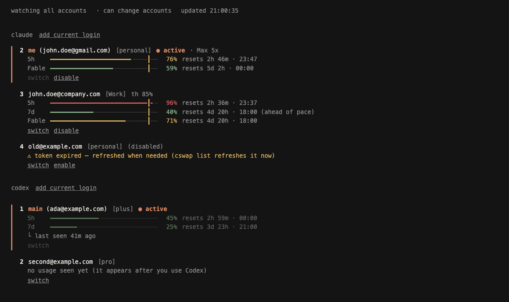

<!-- README rule: say what the user can do, give a minimal example, and mention only caveats that change their decision.
     Mechanics go in docs/, rationale in the PR. When behavior changes, edit the existing text instead of appending. -->

# agent-swap

**Every Claude and Codex account you own, one keystroke apart.**

Switch between your accounts without logging out, let it switch for you before you hit a rate limit, watch every account's usage in a terminal or browser dashboard, and run accounts side by side. Works with the Claude Code CLI, the VS Code extension and the Codex CLI.

[](https://github.com/saurabh-awate96/agent-swap/actions/workflows/ci.yml)
[](LICENSE)




## What you get

- **Switch** Claude Code accounts in one command, with no logout. Pick by number, email or alias, or let `--strategy best` choose the one with the most quota left.
- **Auto-switch** moves you to the next account before the active one hits its 5-hour or weekly limit, with a cooldown so it never flaps. [How the rules work](docs/auto-switch.md)
- **Codex too.** `aswap codex` switches OpenAI Codex CLI logins the same way, from local files. Its own network use is limited to one optional read of the live account's usage through Codex itself. [Details](docs/codex.md)
- **Two dashboards.** A terminal one (`aswap`) and a web control panel (`aswap gui`) that look the same: usage bars, reset countdowns, your switch line, and buttons for everything the terminal does. [How the web one is secured](docs/gui.md)
- **Guided setup.** One install line, then `aswap setup` walks you through saving every login you own.
- **Careful with your logins.** One live copy of each, atomic writes, nothing refreshed in the background for idle accounts. [What it stores and sends](docs/safety.md)

## Installation

### One line (macOS / Linux)

```bash
curl -LsSf https://raw.githubusercontent.com/saurabh-awate96/agent-swap/main/install.sh | sh
```

Installs aswap with uv (or pipx if you have it; it fetches uv from astral.sh if you have neither), adds it to your PATH, then opens [`aswap setup`](#guided-setup). From a clone, run `./install.sh` instead. Re-running it upgrades. `CSWAP_NO_SETUP=1` skips the guided screen; `CSWAP_SPEC` installs from a different path or URL.

Windows (PowerShell, not tested yet): `irm https://raw.githubusercontent.com/saurabh-awate96/agent-swap/main/install.ps1 | iex`

### With uv or pipx

```bash
uv tool install git+https://github.com/saurabh-awate96/agent-swap
# or
pipx install git+https://github.com/saurabh-awate96/agent-swap
```

agent-swap is the former claude-swap fork of [realiti4/claude-swap](https://github.com/realiti4/claude-swap), renamed because it now switches Codex accounts as well. The `claude-swap` on PyPI is the upstream release and does not have `setup`, `gui`, `codex` or `onboard`, so install from this repository.

### From source

```bash
git clone https://github.com/saurabh-awate96/agent-swap.git
cd agent-swap
uv sync
uv run aswap help
```

### Updating

```bash
aswap upgrade          # uv/pipx installs on macOS/Linux: auto-detects and upgrades
# or run your installer directly:
uv tool upgrade agent-swap
pipx upgrade agent-swap
```

Installed from a git URL or a folder, it upgrades from that same source, and the "newer version on PyPI" notice stays off, because PyPI's release is not yours.

### Names

The project is **agent-swap** and the command is **`aswap`**. `agent-swap`, `cswap` and `claude-swap` (the old names) run the same program, so existing scripts, cron lines and habits keep working. Renaming does not touch your saved accounts: the data folders and Keychain entries keep their old `claude-swap` names. The one-line installer replaces an old `claude-swap` install, since both provide `cswap`.

## Usage

### Guided setup

```bash
aswap setup
```

```
  agent-swap · setup
  Every Claude and Codex account you own, one keystroke apart.

  ✓ Claude Code   2.1.319 (Claude Code)
  ✓ Codex CLI     codex-cli 0.167.0

  ○ Claude logins none yet
  ○ Codex logins  none yet

  ↑/↓ and Enter, or press a number
  ❯ 1  Save the account I'm logged into right now
    2  Add more Claude accounts (guided, one login each)
    3  Save my Codex login
    4  Auto-switch: choose when to hop to the next account
    5  Open the web control panel
    6  Open the terminal dashboard
    q  Finish
```

One screen that checks Claude Code and Codex, shows how many logins you have saved, and walks you through the rest: save the login you are on, add more Claude accounts one browser login at a time, save your Codex login, pick the usage % where auto-switch hops, open the web or terminal dashboard. Arrow keys and Enter, or press a number. It only calls the commands below, so it is safe to re-run.

### Add your first account

Log into Claude Code with your first account, then:

```bash
aswap add
```

### Add more accounts

Log in with another account, then:

```bash
aswap add
```

Do not run `/logout` first: current Claude Code may revoke the refresh token stored for the account you are leaving.

Have several accounts to bring in? `aswap onboard` does the loop for you: it asks for each email, runs Claude Code's own `claude auth login --email …` (you sign in in the browser), and saves that login. It never logs anything out.

```bash
aswap onboard
```

### Switch accounts

Rotate to the next account:

```bash
aswap switch
```

Or switch to a specific account:

```bash
aswap switch 2
aswap switch user@example.com
aswap switch dev                # or by alias, once set with `aswap alias 2 dev`
```

Not sure which one? `aswap list` is the dashboard — every account's plan, 5-hour and 7-day usage and reset times at a glance:

```bash
aswap list
```

Or let agent-swap auto-pick by remaining quota — `aswap switch --strategy best` (most quota left) or `--strategy next-available` (skip rate-limited accounts).

**Note:** You usually don't need to restart — on Linux/Windows the new account is picked up automatically, and on macOS after the Keychain cache expires. To apply it instantly, restart Claude Code or reopen the VS Code extension tab. See [Tips](#tips) for the per-platform details.

### Automatic switching

Let agent-swap watch your usage and switch for you. When the active account's 5-hour or 7-day window reaches the threshold (default 90%), it switches to the account with the most quota left — before you hit the limit, and safe to run while Claude Code is working:

```bash
aswap auto                     # foreground loop, polls every 60s
aswap auto --threshold 80      # switch earlier
aswap auto --weekly-threshold 97   # let the weekly window run higher before switching
aswap auto --model Fable       # also switch when the Fable weekly limit is hit
aswap auto --strategy weekly-first   # spend the soonest-expiring weekly quota first (more strategies below)
aswap auto --once              # single check-and-switch, for cron/scripts
aswap auto --dry-run           # log what it would do, never switch
```

<details>
<summary>Strategies, per-account controls & behavior</summary>

**Strategies** (`--strategy`, or `aswap config set autoswitch.strategy`):

| Strategy | Switches | Lands on |
|---|---|---|
| `best` (default) | when the active account reaches its threshold | the account with the most quota left |
| `weekly-first` | same as `best` | the account whose weekly window resets soonest |
| `consume-first` | at the threshold, and earlier whenever an account that resets sooner has room | the account whose weekly window resets soonest |
| `priority-consume-first` | whenever a higher-tier account is usable | your highest tier (`aswap priority`), then the soonest weekly reset |

The weekly ones exist because weekly quota left unused at its reset is lost.

**Per-account controls**

- `aswap disable <num|email>` holds an account out of rotation: auto-switch, bare `aswap switch`, and the `best` / `next-available` strategies skip it until `aswap enable` puts it back. It keeps its login and is still a valid explicit `aswap switch <num|email>` target.
- `aswap threshold <num|email> <pct>` gives one account its own switch-away line (50–99.9) in place of the global one.
- `aswap priority <num|email> <tier>` ranks accounts for `priority-consume-first`: higher tiers (0–1000, default 0) are used first. The other strategies ignore tiers.

**Good to know**

- **Opt-in keepalive.** `aswap config set autoswitch.keepalive true` makes auto-switch send one tiny real `claude` request per idle account (at most one per 8 hours each) so its login and usage stay warm. It uses a little quota, starts that account's 5-hour window, leaves no chat history, and whether scheduled pings are acceptable use is your call. Off by default; details in [docs/auto-switch.md](docs/auto-switch.md).
- **Thresholds are switch-away lines, not hard caps.** With nothing under its line, or the active account at its limit, auto-switch still lands somewhere rather than stall. `priority-consume-first` is the exception: it never lands on an account at or over its line, so it holds and keeps polling.
- A cooldown (default 5 min) and a hysteresis margin stop it flip-flopping between accounts near the threshold.
- `--weekly-threshold 97` gives the 7-day and per-model windows their own line, so the weekly budget can run higher than the 5-hour window. `--threshold`, and any per-account threshold, then governs the 5-hour window only.
- `--model Fable` folds that model's weekly limit into the decision, for when you hit a per-model limit before the account-wide ones. Names are the per-model rows in `aswap list` (e.g. `Fable: 100%`), matched case-insensitively.
- Accounts with no 5-hour window (Ultra) are judged on their 7-day and `--model` windows alone.
- If a usage check fails it keeps using the last-known numbers for a limited time while it retries, and an expired token on an idle machine makes it hold rather than fail over.
- An account whose refresh token has died is quarantined and reported until you [re-add it](#refresh-expired-tokens).
- API-key accounts are never rotated onto unless you pass `--include-api-key-accounts`.

For cron/systemd timers, `--once` reports the outcome in its exit code (`0` switched, `1` error, `2` nothing to do, `3` blocked — no viable target), and `--json` emits one JSON event per line:

```bash
*/5 * * * * aswap auto --once --json >> ~/.cswap-auto.log 2>&1
```

Defaults like the threshold and cooldown are configurable with `aswap config set autoswitch.threshold 80` — flags override them (see [Configuration](#configuration)).

</details>

The exact rules (margins, landing, polling cadence, tier handling) are in [docs/auto-switch.md](docs/auto-switch.md).

### Run multiple accounts at the same time (session mode)

Launch Claude Code as a specific account in the current terminal only — every other terminal and the VS Code extension stay on your default account, so two accounts can work in parallel.

```bash
aswap run 2                     # launch Claude Code as account 2, here only
aswap run user@example.com      # by email
aswap run 2 -- --resume         # everything after '--' is forwarded to claude
aswap run 2 --no-share-history  # keep this account's chat history to itself
```

Sessions use your normal `~/.claude` setup (settings, CLAUDE.md, skills, MCP servers, etc.) and share its chat history, so a conversation started under one account shows up in `--resume` under the others.

<details>
<summary>How it behaves — chat history, MCP servers, tokens</summary>

- **Chat history.** Shared by default: every account reads and writes the history in `~/.claude`. History an account kept on its own before is merged in on its next launch, and nothing already saved is lost (a file that differs on both sides is kept aside in `history-conflicts/` in the backup directory). `aswap config set run.shareHistory false` gives each account its own history; `--no-share-history` does it for one launch.
- **On Windows**, conversations are shared through a directory junction, which needs no special rights; the prompt-history file (`history.jsonl`) is shared only when Windows lets aswap create a symlink (Developer Mode, or an elevated terminal) and otherwise stays per-account.
- **MCP servers.** User-scope MCP servers (`claude mcp add -s user`) are mirrored from your default profile on every launch — manage them there; changes made inside a session don't persist. Definitions are copied as-is (including inline `env`/`headers` values), but MCP OAuth logins are not — HTTP servers may ask you to authenticate once per profile via `/mcp`.
- `--no-share` stops sharing your `~/.claude` setup (settings, skills, etc.) and removes the mirrored MCP config (profiles that never mirrored are left alone). Chat history is separate: it stays shared unless you also pass `--no-share-history`.
- **Your default account.** Running the account that is already your default login launches plain `claude` on that login instead of a session (a second copy of the active credential would go stale). Scripts that need the isolation guaranteed can pass `--require-session`, which refuses instead.
- **Tokens.** A session refreshes its own copy of the account's token; once it exits, the credential it rotated is captured back into the account's stored backup before a switch, swap, move, or usage check uses it. While the session is still running, `aswap switch` refuses to move the default login onto its account if the stored backup has already fallen behind (activating it could only fail) — exit the session first, or pick another account.
- **Usage.** While a session runs, its account's usage is read with the session's own credential, which aswap never refreshes. A read the server refuses shows as token expired, and isn't retried, until the session renews the credential on its next call.

</details>

<details>
<summary>Map accounts to directories — auto-pick per repo</summary>

Bind a directory to an account, and a bare `aswap run` there launches that account in session mode — e.g. work account in work repos, personal elsewhere:

```bash
aswap map 2 ~/work/client-app   # map a directory to account 2
aswap map user@example.com      # map the current directory
aswap map                       # list mappings
aswap unmap ~/work/client-app   # remove one (defaults to current directory)

cd ~/work/client-app/src
aswap run                       # → account 2, session mode
```

Subfolders inherit the nearest mapped ancestor. In an unmapped directory, `aswap run` just launches plain `claude` with your default login. Mappings are per-machine (not part of `aswap export`) and are cleaned up when their account is removed.

</details>

### Interactive dashboard (TUI)

Run `aswap` on its own (or `aswap tui`) for the full-screen dashboard: live usage for every account, switching, and the auto-switcher, all keyboard-driven. `aswap watch` opens it straight to the live monitor. Works on macOS, Linux, and Windows.


### Web control panel (GUI)

`aswap gui` (or `aswap gui`) opens a control panel in your browser: **Claude Code on the left, Codex on the right, the same parts in the same order**, in the terminal dashboard's look (usage bars, reset countdowns, your switch line).

Select an account with the arrow keys or a click: only the selected one shows its buttons, and every action also has a key, listed in the footer (`⏎` switch, `d` disable, `a` alias, `t` threshold, `x` remove, `r` rotate, `b` best, `n` next, `+` add, `v` save login, `g` auto-switch, `f` refresh, `←→` between the panels). What you do lands in an activity log at the bottom; if the dashboard stops, the page says so and marks what it shows as old.

Each panel has:

- **the accounts**, the login in use marked `▸ … ● active`. A login agent-swap has not saved is listed first as `[not saved]` with a save button. Usage windows are named by their real length (`5h`, `7d`, `30d`), and a login OpenAI has revoked says so.
- **switch**: rotate, best, next available (skips accounts at their limit), and on the selected account switch, disable/enable, alias, threshold, remove.
- **add**: account (opens the sign-in in your browser and saves the result; the login in use is saved first, and if no window opens the panel shows the link and, for Codex **by code**, the device code), token or API key, and save login.
- **refresh** (top right, or `f`): checks every account of both providers now and lists each one's state in the activity log (`ok · 7d 74%`, `login revoked: sign in again`), and Codex cards keep a `login ok · checked 3m ago` line. For Codex this asks the real client about each stored login without switching to it. [Details](docs/codex.md#checking-every-stored-login)
- **auto-switch**: start, stop or dry-run it, last events, and settings. Claude's has threshold, weekly line, strategy and keepalive; Codex's shares the threshold. Each runs inside the dashboard and stops with it; run auto-switch in one place only.

```bash
aswap gui                # the control panel
aswap gui --read-only    # a view only: no buttons that change anything
aswap gui --no-open      # print the link instead of opening a browser
```

It listens on `127.0.0.1` only, on a random port, and the link carries a one-time token that changes on every run: if you restart it, open the new link (an old tab says so). Only requests from the page itself are accepted. On a shared machine use `--read-only` or `--no-open`. [Every check and what each button sends](docs/gui.md)

### Refresh expired tokens

If an account's token expires, log back into Claude Code with that account and re-run:

```bash
aswap add
```

This will update the stored credentials without creating a duplicate.

If the refresh token itself has died (auto-switch quarantines and reports such an account), log in with it and re-run `aswap add --slot N`, or replace its stored credentials from a known-good export: a plain `aswap import backup.cswap` replaces dead-token slots on its own (a stale export can carry an already-superseded token).

### OpenAI Codex CLI accounts

`aswap codex` switches the [Codex CLI](https://github.com/openai/codex) login (`~/.codex/auth.json`, or `$CODEX_HOME`). It is separate from your Claude accounts and works from local files: switching makes no request to OpenAI, and aswap never runs `codex login` or `codex logout`. To show the live account's current 5h and weekly numbers when its local reading is stale, it asks the real `codex app-server` (OpenAI's own client, your own login) at most once every five minutes; `aswap config set usage.codexProbe false` turns that off.

```bash
aswap codex add                    # store the login Codex is using right now
codex login                        # ...then log in as the next account
aswap codex add --alias work       # ...and store that one too
aswap codex list                   # accounts, with the last 5h / weekly usage Codex recorded
aswap codex switch                 # rotate; or: switch work | switch 1
aswap codex switch --strategy best # the account with the most quota left (or: next-available)
aswap codex alias 1 work           # a short name; omit it to clear
aswap codex disable work           # hold out of rotate / best / auto-switch (enable returns it)
aswap codex threshold work 85      # its own switch-away line (--unset for the global one)
aswap codex status                 # which stored account is live
aswap codex remove work
```

- **Always `aswap codex add` the current login before running `codex login` for another.** A login aswap does not know is refused, never overwritten.
- **Never `codex logout` a stored account.** It revokes the login on OpenAI's side, so the stored copy stops working.
- **A plain running Codex keeps its account until restarted.** Start it with `aswap codex run` (or `alias codex='aswap codex run'`) and a switch reaches it at once: it reopens on the new login in the same terminal and resumes the same conversation. [How](docs/codex.md#a-running-codex-does-not-notice-unless-it-was-started-with-aswap-codex-run)
- Usage comes from Codex's own session files (`sessions/**/rollout-*.jsonl`), so an idle account shows the numbers from its last session. Use on another device or in the Codex app is not in those files, so these numbers can be lower than OpenAI's own. Only `cli_auth_credentials_store = "file"` (the default) is supported.

### Other commands

```bash
aswap run 2                     # Run an account in this terminal only (session mode)
aswap auto                      # Auto-switch when nearing rate limits (see above)
aswap config                    # Show or edit settings (see Configuration below)
aswap list                      # Show all accounts with 5h/7d usage and reset times
aswap list --token-status       # Add source-labelled OAuth token diagnostics
aswap status                    # Show current account
aswap add --slot 3              # Add account to a specific slot (prompts before overwrite)
aswap add --alias dev           # Add account and give it a short alias
aswap remove 2                  # Remove an account
aswap disable 2                 # Hold an account out of auto-rotation (keeps its login)
aswap enable 2                  # Return a disabled account to rotation
aswap threshold 2 85            # Switch away from account 2 at 85%, not the global default
aswap threshold 2 --unset       # Return account 2 to the global default
aswap threshold                 # Show the global default and every per-account override
aswap priority 2 100            # Use account 2 before lower tiers (priority-consume-first strategy)
aswap priority 2 --unset        # Return account 2 to tier 0
aswap priority                  # Show every account's tier
aswap alias 2 dev               # Give an account a short alias (usable anywhere NUM|EMAIL is)
aswap alias 2 --unset           # Remove an account's alias
aswap alias                     # List all aliases
aswap move 2 1                  # Assign an account to a slot (relocates to an empty slot, swaps if taken)
aswap swap 2 3                  # Exchange two accounts' slot numbers
aswap unclaimed                 # List stashed credential entries (slot + why they were stashed)
aswap unclaimed --purge ID      # Drop one (deletes its bytes; recover with /login + `aswap add`)
aswap tui                       # Interactive dashboard (also: bare `aswap`)
aswap watch                     # Dashboard, opened on the live watch page
aswap upgrade                   # Upgrade agent-swap to the latest version
aswap purge                     # Remove all agent-swap data
```

The original flag spellings (`aswap --switch`, `aswap --list`, ...) keep working.

## Tips

- **Do you need to restart after switching?** Usually not. On **Linux and Windows**, credentials are stored in a file and Claude Code re-reads them whenever that file changes, so the new account takes effect on your next message — no restart needed. On **macOS**, credentials live in the Keychain, which Claude Code caches for about 30 seconds; a running session picks up the switch once that cache expires. Restart Claude Code (or close and reopen the VS Code extension tab) only if you want the change to apply instantly.
- **Continuing sessions after switching:** You can keep using the same Claude Code session after switching — run `aswap switch` in any terminal and carry on. If you'd prefer a clean start, close and reopen Claude Code (or the VS Code extension tab) and use `--resume` to pick your previous session. Either way, the first message on the new account may use extra usage as its conversation cache rebuilds.

## How it works

- Backs up OAuth tokens and config when you add an account
- Swaps only the account-specific Claude login when you switch accounts;
  live account-independent OAuth state (such as MCP server logins) is
  preserved instead of being overwritten by a slot's older snapshot
- Account credentials stored securely using platform-appropriate methods
- Switches (manual and automatic) hold Claude Code's own credential locks while writing, so a swap never interleaves with a token refresh
- Auto-switch freshens a target's token before activating it, and quarantines accounts whose refresh token has died until you [re-add them](#refresh-expired-tokens)
- Usage numbers refresh every few minutes — faster for an account being used or close to switching, slower for idle ones — keeping aswap comfortably inside Anthropic's rate limits however many dashboards you keep open on a machine. An age note like `· 6m ago` just means the next scheduled check hasn't come yet, not that something is stuck.
- The plan shown after each slot (`· Ultra`, `· Pro`, `· Team`) comes from your account profile and refreshes every six hours, independently of usage; a subscription that has lapsed shows as a highlighted `Free`.

## Data locations

| Platform | Credentials | Config backups |
|----------|-------------|----------------|
| Windows | File-based (inside the backup directory, under `credentials/`) | `~/.claude-swap-backup/` |
| macOS | macOS Keychain | `~/.claude-swap-backup/` |
| Linux / WSL | File-based (inside the backup directory, under `credentials/`) | `${XDG_DATA_HOME:-~/.local/share}/claude-swap/` |

Session-mode profiles (`aswap run`) live under the backup directory in `sessions/`. Tool preferences (`settings.json`) and auto-switch state (`autoswitch_state.json` — cooldown and quarantined accounts; delete it to reset) live in the backup directory root.

On Linux/WSL, set `XDG_DATA_HOME` to override the default location.

## Menu bar (macOS)

<details>
<summary>Optional macOS menu bar app — usage at a glance, click to switch</summary>

Needs the `menubar` extra (macOS only):

```bash
uv tool install 'agent-swap[menubar] @ git+https://github.com/saurabh-awate96/agent-swap'
aswap menubar
```

Shows every account's 5h / 7d / spend usage and switches with a click (specific / rotate / best / next-available), plus the TUI's add / disable-enable / remove / refresh actions. `aswap menubar` hands it to launchd and returns: it keeps running after you close the terminal, comes back at login, and is restarted if it crashes. *Quit* in the menu stops it until the next login; *Settings → Start at login* turns the login start off.

Auto-switching is off until you turn it on, with *Settings → Auto-switch accounts* or `aswap menubar --auto-switch`. It runs the same engine as [`aswap auto`](#automatic-switching) with the same `autoswitch.*` settings, so the menu bar and CLI stay in sync, and the menu's first row shows whether it is running, off, or stopped (click to restart) and when usage was last refreshed.

```bash
aswap menubar --service-status      # running? pid? starts at login? auto-switch on?
aswap menubar --auto-switch         # turn auto-switch on (--no-auto-switch: off)
aswap menubar --uninstall-service   # stop it and remove the LaunchAgent
aswap menubar --foreground          # run attached to this terminal, for debugging
```

`aswap upgrade` restarts a running menu bar when the build changed. The wrapper app in `/Applications`, file locations, environment handling and the Login Items switch are in [docs/menubar.md](docs/menubar.md).

</details>

## Advanced

### Configuration

Tool preferences live in `settings.json` in the backup root; `aswap config` reads and edits it with validation, so you never have to find the file or guess valid ranges.

<details>
<summary>Commands & usage</summary>

```bash
aswap config                              # list effective settings ("(default)" = not set)
aswap config get autoswitch.threshold
aswap config set autoswitch.threshold 80  # validated: rejects out-of-range values loudly
aswap config set autoswitch.weeklyThreshold 97  # own switch line for the 7-day/per-model windows
aswap config set autoswitch.model Fable   # per-model switching (see "auto"); Fable,Opus for several
aswap config set run.shareHistory false   # each account keeps its own chat history (see "run")
aswap config set updates.check false      # no daily PyPI lookup for the "newer version" hint
aswap config set usage.headerProbe true   # opt in: setup-token usage via a 1-token request (see "add-token")
aswap config unset autoswitch.threshold   # back to the default
aswap config path                         # where settings.json lives
```

`aswap config --help` lists every key with its valid range and default. Hand-editing the file still works — `aswap config` is just a safer front door. `list` and `get` take `--json` for scripting.

</details>

### Backup and migration

Move account data between machines or back it up:

```bash
aswap export backup.cswap                    # All accounts to a file
aswap export backup.aswap --account 2        # One account
aswap export backup.aswap --full             # Include full ~/.claude.json and credential object (same-PC backup)
aswap import backup.cswap                    # Skips accounts that already exist
aswap import backup.aswap --force            # Overwrite existing
```

The export file is plaintext JSON and, by default, carries only each account's own login — machine-shared MCP/plugin OAuth tokens and the device token stay on the source machine (`--full` keeps everything, for same-PC backups). If you need encryption, pipe through your tool of choice (e.g. `aswap export - | gpg -c > backup.gpg`).

If an imported account is the one you're currently logged in as, activate the imported credentials with `aswap switch N --force` (a plain `switch` to the current account is a safe no-op and won't touch the import).

### Share usage readings between machines

Machines that hold the same accounts can end up sharing one usage-endpoint rate limit, so their polling adds up (this is the limit on how often usage can be read, not your subscription quota). `import-usage` lets one machine poll and hand its readings to the others:

```bash
aswap list --json | ssh laptop aswap import-usage - --hold 600
```

<details>
<summary>How it works — matching, holds & when a hold ends</summary>

Machines share that rate limit when they share a login (moved between them with `export`/`import`, so the same token is live on each), or when the account's usage requests are limited per account rather than per token.

The input is `aswap list --json` output. Each row with `usageStatus: "ok"` is matched to a local account by email and organization, and adopted when it is newer than the reading already stored. Its age comes from `usageAgeSeconds`, so the two machines' clocks never have to agree; a script that delays the hand-over should add the delay to that field. `--hold SECONDS` keeps every collector on the receiving machine (`list`, `status`, `auto`, the dashboard, the menu bar) from fetching those accounts for that long, and the held reading stays trusted for switch decisions meanwhile. A hold never runs past the reading's earliest window reset (per-model windows included), nor past an hour after the reading was taken. Renew it with each hand-over, or lift it early with `--hold 0`; when it lapses, the machine goes back to fetching for itself.

</details>

### JSON output for scripting

Add `--json` to `list`, `status`, or `switch` to emit a single machine-readable JSON object on stdout (human-readable notices go to stderr). Useful for scripting auto-swap and quota tracking.

```bash
aswap list --json                   # all accounts with usage/quota
aswap status --json                 # current active account
aswap switch --strategy best --json # switch, then report the result
aswap switch 2 --json
```

<details>
<summary>Example output</summary>

```json
{
  "schemaVersion": 1,
  "activeAccountNumber": 2,
  "accounts": [
    { "number": 2, "email": "you@example.com", "active": true, "usageStatus": "ok",
      "usage": { "fiveHour": { "pct": 25.0, "resetsAt": "2026-06-22T23:29:59Z" },
                 "sevenDay": { "pct": 16.0, "resetsAt": "2026-06-26T17:59:59Z" } } }
  ]
}
```

Every payload carries a `schemaVersion` (currently `1`); on a handled error stdout is `{"schemaVersion":1,"error":{...}}` with a non-zero exit code. `--switch`/`--switch-to` report `{"switched": true|false, "from": …, "to": …, "reason": …}`.

</details>

`aswap auto --json` emits an event *stream* instead — one JSON object per line (`{"schemaVersion":1,"event":"switch","ts":…, …}` with kinds like `poll`, `switch`, `no-switch`, `account-quarantined`, `all-exhausted`, `error`). The contract is additive: new kinds and fields may appear, so scripts should ignore unknown ones.

Every optional field (usage age, last-known usage, fetch errors, pace, login expiry, …) is listed in [docs/json-output.md](docs/json-output.md).

### Add an account from a raw token or API key

Register a long-lived setup-token (from `claude setup-token`) or a Console API key (`sk-ant-api03-...` workspace key, `sk-ant-usr-...` personal key, or a service-account key) directly, without the browser login — useful on headless servers or when receiving a token from another machine. The token type is auto-detected:

```bash
aswap add-token sk-ant-oat01-...             # OAuth setup-token
aswap add-token sk-ant-api03-...             # API key (any Console key family)
aswap add-token sk-ant-oat01-... --slot 3
aswap add-token - --slot 3                   # read token from stdin
aswap add-token --email user@example.com     # optional label override
```

`--email` is optional; omitted values use `setup-token-{slot}@token.local` (or `api-key-{slot}@token.local` for API keys). No Anthropic API calls are made.

<details>
<summary>Limits — setup-token usage & API-key accounts</summary>

- **Setup-tokens show `usage unavailable` by default**, because the usage endpoint does not answer them (their scope is inference-only). With `aswap config set usage.headerProbe true`, aswap reads their 5h/7d utilization (and Fable's weekly window) from the rate-limit headers of a 1-output-token Haiku request instead, sent at the normal poll cadence. Each probe is a real (tiny) request on that account's subscription, which is why it is off by default.
- **What the probe can't do.** Other per-model windows and extra-usage spend are not in those headers. A reading missing the 5h or 7d window (or a window `autoswitch.model` names) is shown but not used for auto-switching. An account the server rejects for quota is marked as at its limit, with no further probe, until the refusal's `Retry-After` passes.
- **API-key accounts.** Any bare `sk-ant-...` value that is not an OAuth token (`sk-ant-oat...`) registers a managed API-key account (the kind Claude Code uses after `/login` with a key). It switches like any other account, but API keys have no subscription quota, so they show no usage and the usage-aware `switch` strategies never skip them as rate-limited. Use keys scoped to a single workspace: a multi-workspace key needs an `anthropic-workspace-id` header on every request, which Claude Code does not add for a stored key.

</details>

**Note:** Third-party providers configured through `ANTHROPIC_BASE_URL`, `ANTHROPIC_API_KEY` or `ANTHROPIC_AUTH_TOKEN` are not managed or switched; those exported variables stay in effect after a switch, so unset them to use the swapped account.

## Documentation

- [docs/auto-switch.md](docs/auto-switch.md) — the exact auto-switch rules: hysteresis margins, landing rules, per-account thresholds and tiers, polling cadence. Read it to find out why it did or didn't switch.
- [docs/safety.md](docs/safety.md) — what aswap stores, every network call it makes and when, what a ban risk can and cannot mean, and what a failure looks like. Read it before trusting it with accounts you care about.
- [docs/codex.md](docs/codex.md) — how Codex switching works and where its usage numbers come from.
- [docs/gui.md](docs/gui.md) — every check the web control panel applies before it acts, and exactly what each button sends.
- [docs/json-output.md](docs/json-output.md) — every field in `--json` output, including the optional ones. Read it before writing a script against `aswap list --json` or `aswap auto --json`.
- [docs/menubar.md](docs/menubar.md) — how the macOS menu bar runs under launchd: start at login, the wrapper app in `/Applications`, file locations, upgrades, the Login Items switch. Read it when the icon is missing or the service misbehaves.

`aswap --help` and `aswap <command> --help` document every flag.

## Uninstall

Remove all data:

```bash
aswap purge
```

Then uninstall the tool:

```bash
uv tool uninstall agent-swap
# or
pipx uninstall agent-swap
```

## Requirements

- Python 3.12+ (uv fetches it for you if you use the one-line install)
- Claude Code installed and logged in
- Optional: the Codex CLI, for `aswap codex`

## Credits and license

Formerly the claude-swap fork of [realiti4/claude-swap](https://github.com/realiti4/claude-swap) by Onur Cetinkol, which provides the switching engine, the terminal dashboard and the menu bar app. This fork adds the guided setup and installer, Codex support, the web dashboard, `aswap onboard`, the opt-in keepalive, and a round of reliability fixes (see [CHANGELOG.md](CHANGELOG.md)).

Security reports: [SECURITY.md](SECURITY.md). MIT license, see [LICENSE](LICENSE).
