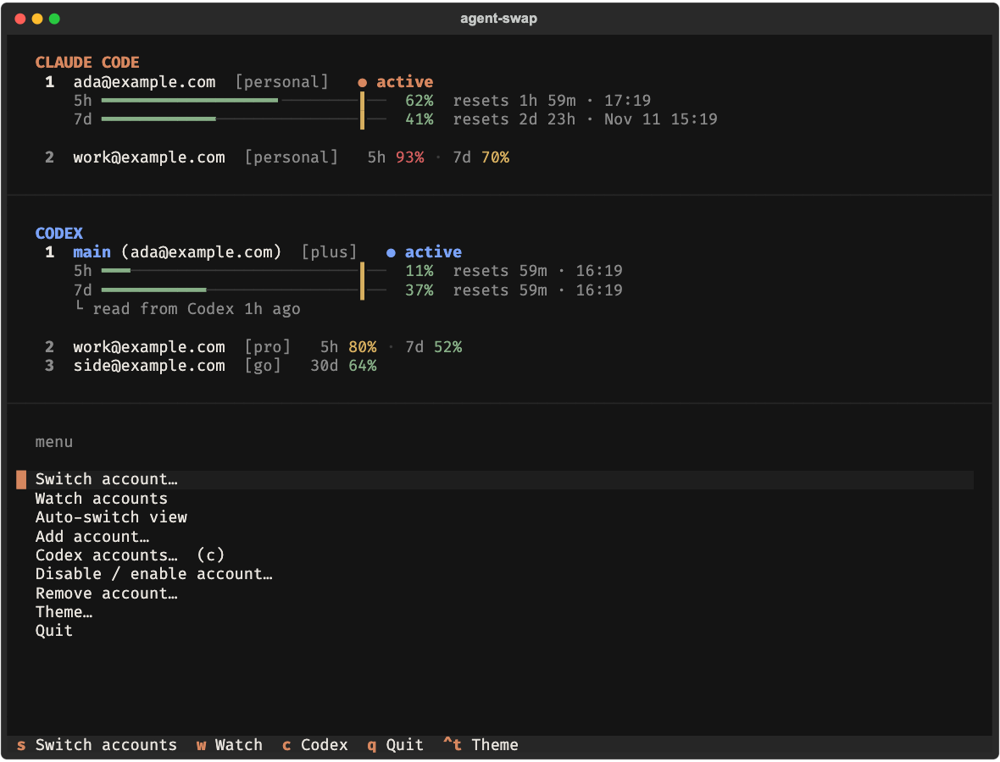

<!-- README rule: say what the user can do, give a minimal example, and mention only caveats that change their decision.
     Mechanics go in docs/, rationale in the PR. When behavior changes, edit the existing text instead of appending. -->

# agent-swap

**Every Claude and Codex account you own, one keystroke apart.**

agent-swap keeps a copy of each login you own (Claude Code and OpenAI Codex CLI) and switches which one your tools use, with no logout. It can move you off an account before you hit a limit, shows every account's usage in a terminal or browser dashboard, and runs two accounts side by side. It is a local app, not a proxy: your requests never pass through it.

[](https://github.com/saurabh-awate96/agent-swap/actions/workflows/ci.yml)
[](LICENSE)


## What you get

- **Switch in one command.** `aswap switch` rotates Claude Code accounts. `--strategy best` picks the one with the most quota left.
- **Auto-switch before a limit.** `aswap auto` moves you off an account nearing its 5-hour or weekly limit, with a cooldown and a margin so it does not flap. [The rules](docs/auto-switch.md)
- **Codex too.** `aswap codex` switches OpenAI Codex CLI logins the same way, reading usage from Codex's own local files. [Details](docs/codex.md)
- **Two dashboards, one look.** A terminal dashboard (`aswap`) and a web control panel (`aswap gui`) share a palette and show every account's usage bars and reset times, with a key or button for every action.
- **Two accounts at once.** `aswap run 2` starts Claude Code on account 2 in this terminal only; everything else stays on your default account.
- **Careful with your logins.** Stored in the macOS Keychain or in owner-only files, written atomically, and idle accounts are never refreshed in the background. [What is stored and sent](docs/safety.md)

## Install

### One line (macOS / Linux)

```bash
curl -LsSf https://raw.githubusercontent.com/saurabh-awate96/agent-swap/main/install.sh | sh
```

This installs `aswap` with uv (or pipx if uv is missing; it fetches uv if you have neither), replaces an older `claude-swap` install, then opens [`aswap setup`](docs/commands.md#aswap-setup). Run it again to upgrade. Set `CSWAP_NO_SETUP=1` to skip the guided screen, or `CSWAP_SPEC` to install from another path or URL. From a clone, run `./install.sh`.

Windows (PowerShell; not tested yet):

```powershell
irm https://raw.githubusercontent.com/saurabh-awate96/agent-swap/main/install.ps1 | iex
```

### With uv, pipx or from source

```bash
uv tool install git+https://github.com/saurabh-awate96/agent-swap
pipx install git+https://github.com/saurabh-awate96/agent-swap
```

The `claude-swap` package on PyPI is the upstream project and has none of this, so install from this repository. From source:

```bash
git clone https://github.com/saurabh-awate96/agent-swap.git && cd agent-swap
uv sync
uv run aswap help
```

To upgrade, run `aswap upgrade` (uv and pipx installs on macOS and Linux upgrade themselves; on Windows it prints the command).

**Names.** The project is agent-swap and the command is `aswap`. `agent-swap`, `cswap` and `claude-swap` run the same program, so old scripts keep working. Your saved accounts are not touched by the rename: the data folders and Keychain entries keep their `claude-swap` names.

## Quick start

```bash
curl -LsSf https://raw.githubusercontent.com/saurabh-awate96/agent-swap/main/install.sh | sh   # 1. install (opens setup)
aswap add                # 2. logged into Claude Code as account one
aswap add                # 3. after /login as account two (do not /logout first)
aswap list               # 4. every account, with 5h and 7d usage
aswap switch             # 5. move to the next account
```

## Claude Code accounts

### Add accounts

Log into Claude Code as an account, then run `aswap add`. For the next account, log in as it (`/login` inside Claude Code) and run `aswap add` again. Do not run `/logout` first: current Claude Code can revoke the refresh token of the account you are leaving.

To add several accounts in one sitting, run `aswap onboard`. It asks for each email, runs Claude Code's own `claude auth login --email …` in your browser, and saves the result. It never logs anything out.

A setup token or API key works too, without a browser login: `aswap add-token sk-ant-oat01-…`. See [commands](docs/commands.md#add-accounts).

### Switch

```bash
aswap switch                    # the next account
aswap switch 2                  # by number, email or alias
aswap switch --strategy best    # the account with the most quota left
aswap list                      # every account, with 5h and 7d usage and reset times
```

Accounts can have short names (`aswap alias 2 work`), a per-account switch-away line (`aswap threshold 2 85`) and be held out of rotation (`aswap disable 2`).

### Do I need to restart after switching?

Usually not. On Linux and Windows, Claude Code re-reads its credentials file on your next message. On macOS, it caches the Keychain for about 30 seconds, so a running session picks up the switch after that. Restart Claude Code, or reopen the VS Code extension tab, to apply it immediately.

### Run two accounts at once

```bash
aswap run 2                     # Claude Code as account 2, in this terminal only
aswap run 2 -- --resume         # arguments after -- go to claude
```

Other terminals and the VS Code extension stay on your default account. Chat history is shared by default, so a conversation started under one account appears in `--resume` under the others. [How session mode behaves](docs/commands.md#aswap-run)

### Refresh expired tokens

If an account's token expires, log into it again and run `aswap add`. This updates the stored login without creating a duplicate. If the refresh token itself has died, auto-switch reports the account; re-add it with `aswap add --slot N`, or import a known-good export with `aswap import backup.cswap`.

## Codex accounts

`aswap codex` switches the [Codex CLI](https://github.com/openai/codex) login (`$CODEX_HOME/auth.json`, default `~/.codex/auth.json`). It is separate from your Claude accounts and works from local files: switching makes no request to OpenAI.

```bash
aswap codex add --alias work     # store the login Codex is using now, with a short name
codex login                      # then sign in as the next account
aswap codex add                  # store that one too
aswap codex list                 # accounts, with the last 5h and weekly usage
aswap codex switch               # rotate, or: aswap codex switch work
aswap codex switch --strategy best
aswap codex run                  # Codex that follows a switch (POSIX only)
```

- **Run `aswap codex add` for the current login before `codex login` for another.** `aswap codex switch` refuses to replace a login aswap has not stored.
- **Never run `codex logout` on a stored account.** It revokes the login on OpenAI's side, so the stored copy dies too.
- **A plain running Codex keeps its account until it restarts.** Start it with `aswap codex run` (or `alias codex='aswap codex run'`) and a switch reopens it on the new login in the same terminal, resuming the same conversation.

Full command list, usage numbers and the live-account reading: [docs/codex.md](docs/codex.md).

## Claude or Codex?

| | Claude Code | Codex CLI |
|---|---|---|
| Store a new login | `aswap add` (after `/login`), or `aswap onboard` | `codex login`, then `aswap codex add` |
| Switch | `aswap switch` | `aswap codex switch` |
| Usage comes from | Anthropic's usage endpoint, polled | Codex's session files; the live account is read through `codex app-server` |
| Auto-switch | `aswap auto`, web panel, menu bar | web panel only |
| Two accounts at once | `aswap run N` (one account per terminal) | `aswap codex run` (one Codex that follows switches) |
| Per-account alias, threshold, disable | yes | yes |
| Menu bar (macOS) | yes | no |
| Platforms | macOS, Linux, Windows (untested) | macOS, Linux, Windows (untested); file credential store only |

## The web control panel

```bash
aswap gui                # opens the control panel in your browser
aswap gui --read-only    # a view only: no button changes anything
aswap gui --no-open      # print the link instead (shared machines)
```

The page has two parts. Light and dark follow your system, and a small coloured dot tells Claude Code and Codex apart.

- **Active now**: one card per product with the account in use and its limits, worded like Claude's own usage page ("Current session — Resets 7:40 PM — 50% used"), with a tick on each bar at the switch-away line. The card holds the Auto-switch toggle, Dry run, its settings and Best account. A login you have not saved yet is flagged there, with a Save button.
- **Accounts**: one table for both products, with tabs for All, Claude Code and Codex. Click a row to open its details: switch, refresh, alias, switch-away line, disable or remove.

**+ Add account** opens one dialog: sign in with the browser, save the login in use, or use a token or API key. Every action shows a toast and goes into an Activity list at the bottom.

Every action has a key, and `?` lists them in the page:

| Key | Action | Key | Action |
|---|---|---|---|
| `↑` `↓` / `j` `k` | select account | `Enter` | switch to it |
| `u` / `f` | refresh selected / all | `Esc` | close details |
| `d` | disable / enable | `a` / `t` | alias / switch-away line |
| `x` | remove | `+` | add account |
| `r` / `b` / `n` | rotate / best / next not at its limit | `g` | auto-switch on / off |
| `1` `2` `3` | all / Claude Code / Codex | `?` | list the keys |

Keys do nothing while a dialog is open, in read-only mode (which also hides Refresh and Add), or while a sign-in is waiting.

The panel listens on `127.0.0.1` only, on a random port, and the link carries a one-time token that changes on every run. Only requests from the page itself are accepted. What each check and button sends: [docs/gui.md](docs/gui.md).

## The terminal dashboard

```bash
aswap            # the dashboard (bare aswap in an interactive terminal)
aswap watch      # opens on the live monitor
```



The look matches the web panel: a violet accent, and bars that stay neutral until they turn amber, then red, near a limit. Navigate the menu with the arrow keys or `j` / `k`, press Enter to choose, and `Esc` or `←` to go back.

| Key | Action |
|---|---|
| `s` | switch accounts (Enter switches, `b` picks the best) |
| `w` | watch: live monitor of every account |
| `g` | auto-switch view (starts in dry run; `l` goes live) |
| `c` | Codex accounts |
| `f` | refresh usage now |
| `Ctrl+t` | cycle dark, light and auto themes |
| `q` | quit |

Every screen and menu entry is in [docs/tui.md](docs/tui.md).

## The menu bar (macOS)

```bash
uv tool install 'agent-swap[menubar] @ git+https://github.com/saurabh-awate96/agent-swap'
aswap menubar                     # starts it at login, in the background
```

Every account's usage in the menu bar, with a click to switch (specific account, rotate, best or next available). It also runs auto-switch when you turn it on in *Settings*, with the same `autoswitch.*` settings as the CLI. Launch agent details and troubleshooting: [docs/menubar.md](docs/menubar.md).

## Automatic switching

```bash
aswap auto                              # watch in the foreground; switch at 90% of the 5-hour window
aswap auto --threshold 80 --weekly-threshold 97
aswap auto --dry-run                    # report what it would do, never switch
aswap auto --once --json                # one check, for cron or a timer
```

Auto-switch looks at each account's usage windows, moves to the account that is best placed when the active one reaches its line, and waits a cooldown (5 minutes by default) between proactive switches. Strategies (`--strategy`):

| Strategy | Use it when |
|---|---|
| `best` (default) | you want the account with the most quota left |
| `weekly-first` | you want to spend the weekly quota that resets soonest first |
| `consume-first` | weekly quota expires unused, so use the soonest-resetting account even below the line |
| `priority-consume-first` | you rank accounts (`aswap priority`) and want the top tier used first |

Keepalive (`aswap config set autoswitch.keepalive true`) sends one tiny real request to idle accounts so their logins stay warm. It is off by default because each ping is a real request that starts that account's 5-hour window. The exact rules and per-account controls: [docs/auto-switch.md](docs/auto-switch.md).

## Configuration

Settings live in `settings.json` in the backup directory. `aswap config` reads and writes them with validation, so you never need to find the file.

```bash
aswap config                                  # every setting and its effective value
aswap config set autoswitch.threshold 80      # rejects values out of range
aswap config unset autoswitch.threshold       # back to the default
aswap config path                             # where settings.json lives
```

| Key | Default | What it does |
|---|---|---|
| `autoswitch.threshold` | `90` | switch-away line for the 5-hour window (50 to 99.9) |
| `autoswitch.weeklyThreshold` | same as threshold | its own line for the 7-day and per-model windows |
| `autoswitch.strategy` | `best` | target selection for auto-switch |
| `autoswitch.model` | none | also switch on a per-model weekly limit, e.g. `Fable` |
| `autoswitch.keepalive` | `false` | the keepalive described above |
| `usage.codexProbe` | `true` | ask Codex itself for the live account's usage when local files are stale |
| `run.shareHistory` | `true` | `aswap run` shares one chat history across accounts |
| `ui.theme` | `auto` | `dark`, `light` or `auto` |
| `updates.check` | `true` | the daily PyPI check behind the "newer version" hint |

`aswap config --help` lists every key with its range, and [docs/auto-switch.md](docs/auto-switch.md) covers the auto-switch keys.

## Data locations

| | macOS | Linux / WSL | Windows |
|---|---|---|---|
| Stored Claude logins | Keychain | files in the backup directory (`credentials/`) | files in the backup directory (`credentials/`) |
| Stored Codex logins | Keychain items `codex-N` | files in `codex/credentials/` | files in `codex/credentials/` |
| Backup directory (settings, rosters, state) | `~/.claude-swap-backup/` | `${XDG_DATA_HOME:-~/.local/share}/claude-swap/` | `~/.claude-swap-backup/` |

`aswap run` profiles live in `sessions/` under the backup directory. Auto-switch state (cooldown, quarantined accounts) is `autoswitch_state.json`; delete it to reset. `XDG_DATA_HOME` overrides the Linux location.

## Safety

- agent-swap keeps a copy of each login you add. It never reads another app's login and never sends a login anywhere except to the service it belongs to.
- Refresh tokens are single use, so a login must live in one place. Use `aswap export` and `aswap import` to move an account, and do not `/logout` or `codex logout` an account agent-swap manages.
- It does not refresh idle accounts in the background. An idle account whose token lapsed shows "token expired" until you use it or run `aswap list`.
- Nothing here can promise a provider will never object to several accounts, automatic switching or scheduled requests. Read the terms that apply to your plan. [What it stores, what it sends and what a ban risk can mean](docs/safety.md)

## Limits

These change what you can rely on:

- Codex auto-switch runs only inside the web control panel. There is no `aswap auto` for Codex.
- `aswap codex run` is POSIX only (macOS and Linux).
- Windows is untested for `install.ps1` and for the sign-in flows.
- A plain Codex that is already running keeps its account until it restarts.
- Codex usage from local files covers this machine only. Use on another computer or in the Codex app does not show.
- Third-party providers set through `ANTHROPIC_BASE_URL`, `ANTHROPIC_API_KEY` or `ANTHROPIC_AUTH_TOKEN` are not switched. Unset them to use the swapped account.

## Documentation

- [docs/README.md](docs/README.md): index of the reference docs.
- [docs/commands.md](docs/commands.md): every command and flag, including session mode and backup.
- [docs/auto-switch.md](docs/auto-switch.md): the exact auto-switch rules.
- [docs/codex.md](docs/codex.md): Codex switching, usage numbers and `aswap codex run`.
- [docs/gui.md](docs/gui.md): the web control panel, its checks and its keys.
- [docs/tui.md](docs/tui.md): the terminal dashboard, its screens and keys.
- [docs/safety.md](docs/safety.md): what is stored, what is sent, and what can go wrong.
- [docs/json-output.md](docs/json-output.md): every field of `--json` output.
- [docs/menubar.md](docs/menubar.md): the macOS menu bar app and its launch agent.
- [CONTRIBUTING.md](CONTRIBUTING.md), [SECURITY.md](SECURITY.md), [CHANGELOG.md](CHANGELOG.md).

## Uninstall

```bash
aswap purge                      # removes agent-swap's stored logins and data
uv tool uninstall agent-swap     # or: pipx uninstall agent-swap
```

`aswap purge` does not list Codex's Keychain items (`codex-N`) in what it removes. Run `aswap codex remove N` for each Codex account first. [Details](docs/codex.md#removing-codex-accounts)

## Requirements

- Python 3.12 or newer (uv fetches it for you with the one-line install).
- Claude Code, installed and logged in, for the Claude side.
- Optional: the Codex CLI, for `aswap codex`.

## Credits and license

agent-swap is a fork of [realiti4/claude-swap](https://github.com/realiti4/claude-swap) by Onur Cetinkol, which provides the switching engine, the terminal dashboard and the menu bar app. This fork adds the guided setup and installer, Codex support, the web control panel, `aswap onboard`, the opt-in keepalive, and a round of reliability fixes. See [CHANGELOG.md](CHANGELOG.md).

MIT license, see [LICENSE](LICENSE). Security reports: [SECURITY.md](SECURITY.md).
