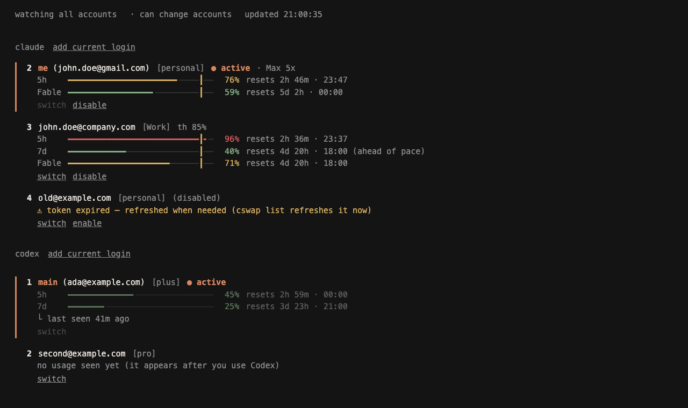

# Web control panel

Reference for `aswap gui`: what the page shows, every key, and how the server is protected. Everyday use is in the [README](../README.md#the-web-control-panel).

```bash
aswap gui                          # opens the panel in your browser
aswap gui --read-only              # a view only: every write answers 403
aswap gui --no-open                # print the link instead of opening a browser
aswap gui --port 8765              # a fixed port, e.g. for an SSH tunnel
```



## The page

Claude Code is on the left and Codex on the right, with the same parts in the same order. On a narrow window they stack. Each panel has:

- **the accounts.** The login in use is marked `▸ … ● active`. A login agent-swap has not saved yet is listed first as `[not saved]`, with a save button. Usage windows are named by their real length (`5h`, `weekly`, `30d`), and a revoked login says so.
- **switch** (the panel's own actions): rotate, best, next available. On the selected account: switch, disable or enable, alias, threshold, remove.
- **add:** account (opens the sign-in in your browser and saves the result), token or API key, and save login.
- **refresh** (top right, or `f`; `u` or the account's own refresh button for one account).
- **auto-switch:** start, stop or dry run; its last events; its settings. Claude's has the threshold, the weekly line, the strategy and keepalive. Codex's has the threshold. Each runs inside this process and stops with the dashboard.

Selecting an account (arrow keys or a click) shows its actions. Other accounts show only their status.

### Keys

Every action has a key, listed in the footer.

| Key | Action |
|---|---|
| `↑` `↓` or `j` `k` | select an account in the current panel |
| `←` `→` or `h` `l` | move to the other panel |
| `Enter` | switch to the selected account |
| `d` | disable or enable the selected account |
| `a` | alias |
| `t` | threshold |
| `x` | remove |
| `r` | rotate to the next account |
| `b` | switch to the best account (most quota left) |
| `n` | switch to the next available account (skips those at their limit) |
| `+` | add an account |
| `v` | save the login in use |
| `g` | start or stop auto-switch (`dry run` is a button, not a key) |
| `f` | refresh every account of both providers |
| `u` | refresh the selected account |

Keys do nothing while a dialog is open, in read-only mode, or while a browser sign-in is waiting for you.

### Activity and status

What you do lands in an activity log at the bottom, with the outcome of each check (`ok · 7d 74%`, `login revoked: sign in again`). If the server stops, the page says so in a banner and dims what it shows; it keeps trying, and a link from an earlier run is told to open the new one.

### Refresh

`f` (or the top-right button) checks every account now and lists each one's state in the activity log. For Claude that is what `aswap list` does: usage is read again where it is older than the serve window, and an expired idle token is refreshed on request. For Codex it asks the real client about each stored login without switching to it (see [codex.md](codex.md#checking-every-stored-login)).

Background polling never refreshes an idle account's token. Only this button does, and only for a token that has already expired.

## How the server is protected

A browser page that can switch accounts is an attack surface: any website open in your browser could try to talk to a local server. The panel is built so that outside pages cannot drive it. Every request must pass these checks, in order:

1. **Bind.** `127.0.0.1` only, on a random free port (or the one you give with `--port`). Never `0.0.0.0`.
2. **Host header.** Must be `127.0.0.1:PORT` or `localhost:PORT`, the address the server started on. This defeats DNS rebinding, where a hostile site points its own name at your machine.
3. **Origin.** Any request that carries an `Origin` must come from the panel's own origin, and a POST must carry one. `Sec-Fetch-Site` must be `same-origin` or `none`. Cross-site requests are rejected. There is no CORS answer, so a cross-site preflight fails.
4. **Bodies.** A POST body must be a JSON object with `Content-Type: application/json`, have a `Content-Length`, and be at most 4 KiB. Chunked bodies are refused. A form post from another site cannot be JSON.
5. **Token.** A random per-run secret. It travels in the URL **fragment** (`#…`), which browsers never send to a server or in a `Referer`. The page moves it to `sessionStorage` and clears the address bar. Every `/api` request must send it as a bearer token, and the comparison is constant-time.
6. **Read-only.** With `--read-only`, every POST answers `403` before anything runs. GET requests still work. (`--write` is still accepted and does nothing.)

Responses carry a strict `Content-Security-Policy` (own origin only, no inline script, no framing), `X-Frame-Options: DENY`, `no-store`, and `no-referrer`. Requests with any other method get `405`.

### What the page can do

Both providers expose the same actions under `/api/claude/<action>` and `/api/codex/<action>`. A test pins that the two sets are equal. The Claude-only paths from earlier versions (`/api/switch`, `/api/add-current`, …) still answer.

| Endpoint | Method | Does | Read-only |
|---|---|---|---|
| `/api/settings`, `/api/claude`, `/api/codex`, `/api/<provider>/auto` | GET | accounts, usage, the login in use, the auto-switch state and its last events | works |
| `/api/<provider>/switch`, `rotate`, `disable`, `remove` | POST | switch to a slot; rotate (`next`, `best`, `next-available`); hold out of rotation; remove | 403 |
| `/api/<provider>/alias`, `threshold` | POST | an account's short name and its own switch-away line | 403 |
| `/api/<provider>/save` | POST | save the login in use | 403 |
| `/api/<provider>/token` | POST | add a setup token or API key (Claude), or log Codex in with an API key | 403 |
| `/api/<provider>/refresh` | POST | check every account of that provider, or the one in an optional `number`, and report each state | 403 |
| `/api/<provider>/login` | POST | start the sign-in in the browser, then save the result | 403 |
| `/api/<provider>/auto` | POST | start, stop or dry-run the auto-switch engine | 403 |
| `/api/<provider>/config` | POST | change the auto-switch settings | 403 |

The sign-in starts `claude auth login [--email]` for Claude, and `codex login` or `codex login --device-auth` for Codex. An API key is `codex login --with-api-key` with the key on standard input.

### What each value is checked against

- **Accounts** are named by slot **number** (digits only, up to three), never by email, alias, path or command.
- **Settings** are limited to four keys for Claude (`autoswitch.threshold`, `.weeklyThreshold`, `.strategy`, `.keepalive`) and to `autoswitch.threshold` for Codex. Values go through the same validation as `aswap config set`.
- **Sign-in** runs one fixed command without a shell and with no input. The only variable part is an optional email, checked against the same pattern `aswap add` uses. Signing in replaces the login in use, so an unsaved one is **saved first**, and the sign-in is refused if that save fails. The command's output is read only for the sign-in link (https only) and the device code, which the page shows if no browser window opened. While a sign-in is open, other changes answer `409`; auto-switch and its settings stay available. The process is stopped after five minutes, and the new login is saved only if it exited cleanly.
- **Tokens** are taken from the request body. They are never logged, and they are removed from any message sent back.
- **Writes** run one at a time; a second one answers `409`.
- **No endpoint returns a token or credential.** The page receives emails, aliases, plans and percentages.

Nothing from the page reaches a shell.

### Auto-switch from the page

The Claude auto-switch started from the page is the same engine `aswap auto` runs, inside this process. Codex's is a smaller engine of the same shape: it reads usage, and when the live account reaches the line it moves to the least-used enabled account under its own line, with a five-minute cooldown. A running Codex keeps its account until it restarts (see [codex.md](codex.md#running-codex-and-switches)). Both stop when the dashboard stops. Run auto-switch in one place only, since two engines on the same accounts can fight.

## Logins that are not saved yet

If the login Claude Code or Codex is using is not stored in agent-swap, the page lists it first, marked `[not saved]`, with its address (and plan, for Codex) only. It has a save button; in read-only mode the entry says which command to run. For Claude the address comes from `.claude.json`, and for Codex from `auth.json`. Neither reads the Keychain or the network.

## In the browser

The page refreshes on a timer and re-renders in one step, so there is no rebuild under your cursor. It skips a refresh while a click is in progress, and it never rebuilds under an open dialog. Every value from outside the page (email, alias, organisation name) is placed with `textContent`, never parsed as HTML.

## Shared machines

The token protects against other websites, not against other users of the same computer who can read your terminal or your process list. On a shared machine, use `--no-open` and paste the link yourself, or use `--read-only`.
