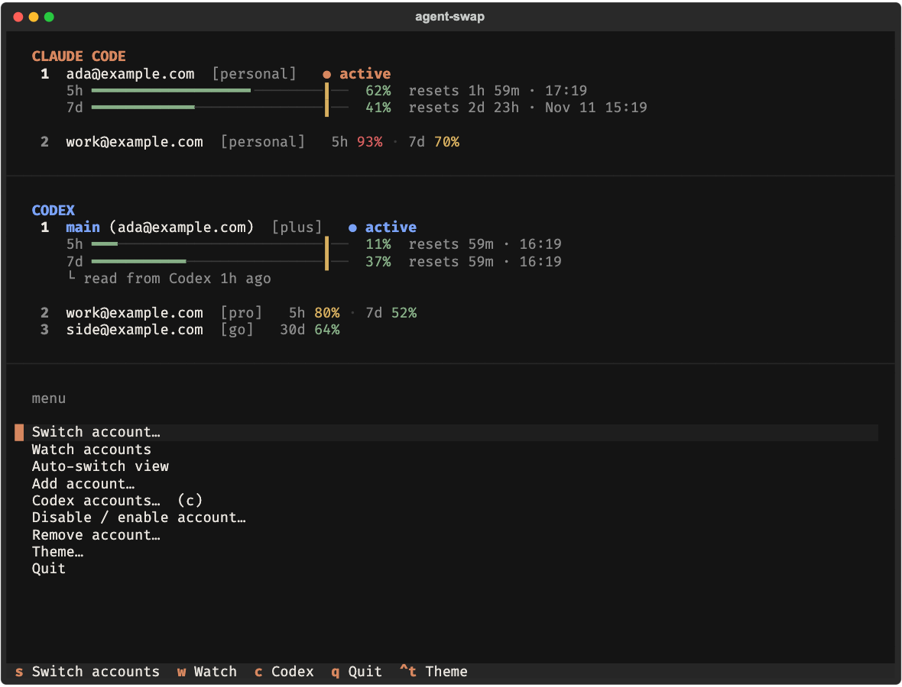

# Terminal dashboard

Reference for the full-screen terminal dashboard. Everyday use is in the [README](../README.md#the-terminal-dashboard).

```bash
aswap            # bare aswap in an interactive terminal opens it
aswap tui        # the same, spelled out
aswap watch      # opens straight on the live monitor
```

Bare `aswap` opens the dashboard only when both stdin and stdout are a terminal. In scripts and pipes it still prints usage, so `aswap` never blocks a cron job.



## The dashboard

The top of the screen is the monitor: the account in use as a full card, the others as one-line minis, each with its 5-hour and 7-day usage bars and reset times. Bars are amber from 70% and red from 90%, and a tick marks the switch-away line. A row whose stored measurement just advanced is highlighted briefly.

Below it is the action menu. The arrow keys (or `j` and `k`) move through the menu, Enter chooses, and `Esc` or `←` goes back one level. Menus nest, and the breadcrumb sits above the list.

### Menu

| Entry | What it opens or does |
|---|---|
| Switch account… | the switch screen (below) |
| Watch accounts | the watch screen (below) |
| Auto-switch view | the auto-switch screen (below) |
| Add account… | **From current Claude Code login** saves the login in use; **From a setup-token / API key…** asks for the token and saves it |
| Codex accounts…  (c) | the Codex menu (below) |
| Disable / enable account… | one row per account; selecting it toggles the account |
| Remove account… | one row per account, then a confirmation |
| Theme… | dark, light or auto, with the active one marked |
| Quit | exits |

`s`, `w`, `g`, `c`, `f` and `q` work from the dashboard without going through the menu.

### Codex menu

The Codex entry sits right after *Add account…*. Its panel, a **CODEX** heading and the live account card under the Claude panel, uses Codex's own blue (terracotta is Claude's), so you can tell the products apart at a glance. Codex's data is polled on its own slower clock, about every 30 seconds, because the live reading is cached for five minutes.

| Entry | What it does |
|---|---|
| Switch Codex account… | the Codex switch screen |
| Rotate to the next account | the next stored Codex login |
| Best pick (most quota left) | the Codex login with the most headroom |
| Sign in to another account… | leaves the dashboard, runs `codex login` in the same terminal, then comes back |
| Save current login | stores the login in use (refused if OpenAI has revoked it) |
| Check every login now | asks the real client about every stored login, without switching |
| Disable / enable account… | toggles one Codex account |
| Remove account… | removes one Codex account after a confirmation |

A Codex login OpenAI has revoked is shown as `revoked`, with a note to sign in again. Codex auto-switch is not in the terminal dashboard; it runs in the web panel only. See [codex.md](codex.md).

## Screens

### Switch screen

Every account full-size. Arrows move the cursor, Enter switches and returns to the dashboard.

| Key | Action |
|---|---|
| `↑` `↓` / `j` `k` | move |
| `Enter` | switch to the highlighted account |
| `b` | best pick (most quota left) |
| `Esc` / `q` / `s` | back |

The Codex switch screen works the same way, with one more key: `n` picks *next available*, which skips accounts at their limit. `b` is best pick, Enter switches, and `Esc`, `q` or `s` go back.

### Watch screen

A live monitor of every account, read-only by default. Its title line shows the refresh status.

| Key | Action |
|---|---|
| `s` | arm selection: the cursor appears on the account in use |
| `Enter` | with selection armed, switch to the highlighted account and **stay on the watch screen** |
| `s` again or `Esc` | disarm selection (`Esc` with selection off leaves the screen) |
| `f` | refresh usage now |
| `q` | leave the screen |

### Auto-switch screen

Opens in **dry run**: it reports what it would do and never switches. The badge at the top says `DRY-RUN` or `LIVE`, and a log below lists the engine's events (polls, switches, quarantined accounts, exhausted accounts).

| Key | Action |
|---|---|
| `l` | go live, or back to dry run. Going live asks for confirmation first |
| `t` | adjust the threshold: then `←` and `→` move it by 1 point |
| `Enter` | finish adjusting |
| `Esc` / `q` | back |

A threshold changed here is for this session only. It is not written to `settings.json`, and leaving the screen restores the configured value. Change the saved one with `aswap config set autoswitch.threshold N`. The rules the engine follows are in [auto-switch.md](auto-switch.md).

The engine stops when you leave the screen and is not left running in the background. For background switching use `aswap auto` or the menu bar app.

## Themes

`Ctrl+t` cycles dark, light and auto from anywhere. The Theme entry in the menu does the same. The choice is saved as `ui.theme` in `settings.json`. Auto follows the terminal background.

## Confirmations

Removing an account, and going live on the auto-switch screen, ask first. In a confirmation, `y` confirms, `n` or `Esc` cancels, and `←` `→` move between the buttons.

## Notes

- Rows you have not used lately show their last measurement with its age, as the CLI does.
- An account whose token has lapsed shows as `token expired`. The dashboard does not refresh idle accounts' tokens in the background; `f` refreshes usage, and an expired idle token is refreshed only on request (as `aswap list` does).
- The dashboard runs the same switching code as the command line, so a switch made here takes the same locks and follows the same rules as `aswap switch`.
